# Docker Security Lab - DVWA Containerisation

## Overview
This lab demonstrates core containerisation skills using Docker Desktop on Windows. I deployed the **Damn Vulnerable Web Application (DVWA)** - a deliberately insecure PHP/MySQL web app used by security professionals to practice common web vulnerabilities in a safe, isolated environment. In the second part of this lab, I used DVWA to exploit and then detect two OWASP Top 10 vulnerabilities (SQL injection and XSS), linking the attack to what a SOC analyst would see in the web server logs

**Skills demonstrated:** Docker image management, container lifecycle (run/stop/remove), port mapping, loopback networking, containerised web application deployment , OWASP Top 10 testing (SQL injection, XSS), and log-based attack detection.

--------------------------------------------------------------------------------------------------------------------------------------------------------------------------------------------

## Environment
|   Component    |         Detail                    |
|----------------|-----------------------------------|
| Host OS        |         Windows 11                |
| Docker Desktop |          v4.98.0                  |
| Docker Engine  |    Running (WSL2 backend)         |
| Image          | `vulnerables/web-dvwa:latest`     |
| Container port |    80 (internal) → 8080 (host)    |

--------------------------------------------------------------------------------------------------------------------------------------------------------------------------------------------


## Steps Completed

### 1. Pull the DVWA Image
```bash
docker pull vulnerables/web-dvwa
```
Downloaded the DVWA image from Docker Hub. Docker stores this locally so containers can be spun up instantly without downloading again.

**Evidence:** `Status: Image is up to date for vulnerables/web-dvwa:latest`

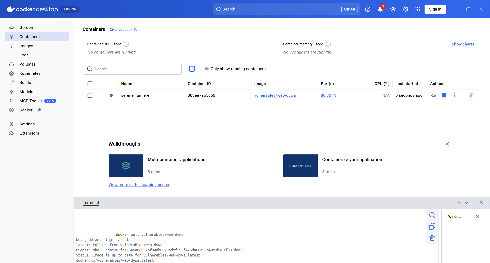

--------------------------------------------------------------------------------------------------------------------------------------------------------------------------------------------


### 2. First Run — Port 80 (Troubleshooting)
```bash
docker run -d -p 80:80 vulnerables/web-dvwa
```
Initial attempt mapped the container to host port 80 (container name: `serene_lumiere`). The container started and `docker ps` confirmed it was running, but navigating to `http://localhost` in Microsoft Edge returned:

> `ERR_CONNECTION_RESET - The connection was reset.`

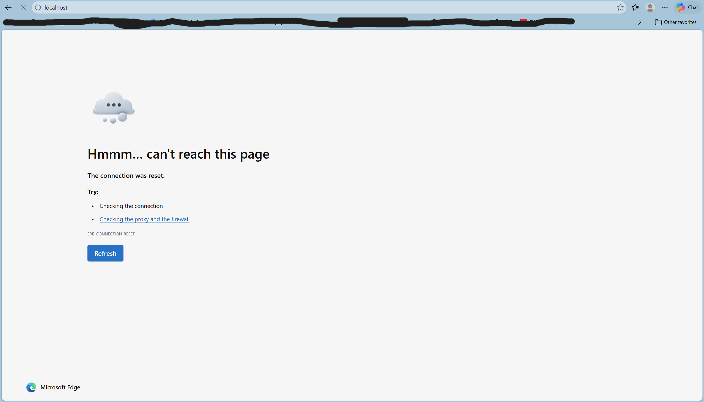

**Diagnosis step 1 — Check container logs:**
```bash
docker logs serene_lumiere
```
Output confirmed the container itself was healthy:
- `[+] Starting mysql...` → MariaDB started successfully
- `[+] Starting apache` → Apache 2.4 started successfully

This ruled out a container failure. The issue was at the host level — Windows or Edge's proxy settings were intercepting port 80 before it reached Docker.

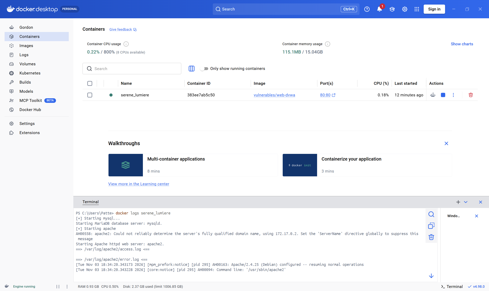

**Diagnosis step 2 — Test with curl:**
```bash
curl http://localhost:8080
```
Returned a PowerShell error (`InvalidOperation: WebCmdletWebResponseException`) — because `curl` in Windows PowerShell is an alias for `Invoke-WebRequest`, not the real Unix curl binary. This confirmed the browser, not the container, was the issue.

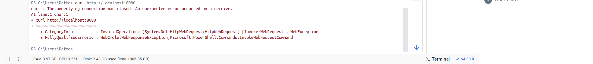

**Resolution:** Used `http://127.0.0.1:8080` in the browser instead of `http://localhost`. The loopback IP bypasses Edge's proxy settings and connects directly — DVWA loaded successfully.

--------------------------------------------------------------------------------------------------------------------------------------------------------------------------------------------


### 3. Resolution - Remap to Port 8080
```bash
docker stop serene_lumiere
docker run -d -p 8080:80 vulnerables/web-dvwa
```

|     Flag     |               Meaning                    |
|--------------|------------------------------------------|
|     `-d`     | Detached mode — runs in the background   |
| `-p 8080:80` | Maps host port 8080 to container port 80 |

Stopped the original container and re-ran with port 8080 instead (container name: `gallant_pare`), avoiding the Windows port 80 reservation conflict.

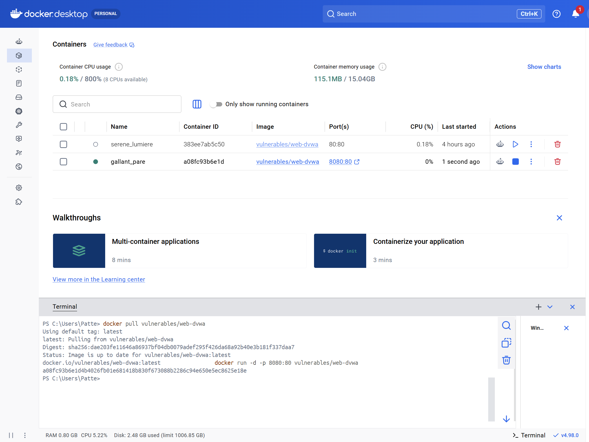

--------------------------------------------------------------------------------------------------------------------------------------------------------------------------------------------


### 4. Verify Container is Running
```bash
docker ps
```
Confirmed container `gallant_pare` status: **Up**, with correct port mapping `0.0.0.0:8080->80/tcp`.

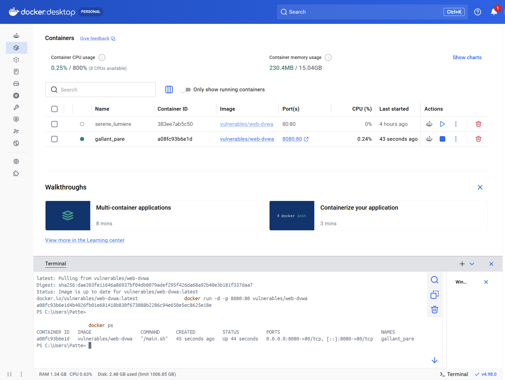

--------------------------------------------------------------------------------------------------------------------------------------------------------------------------------------------


### 5. Access DVWA in Browser
Navigated to `http://127.0.0.1:8080` in Microsoft Edge.

> **Note:** `localhost` was intercepted by Edge's proxy settings. Using `127.0.0.1` (the loopback address) bypassed this, demonstrating knowledge of IP addressing and loopback networking.

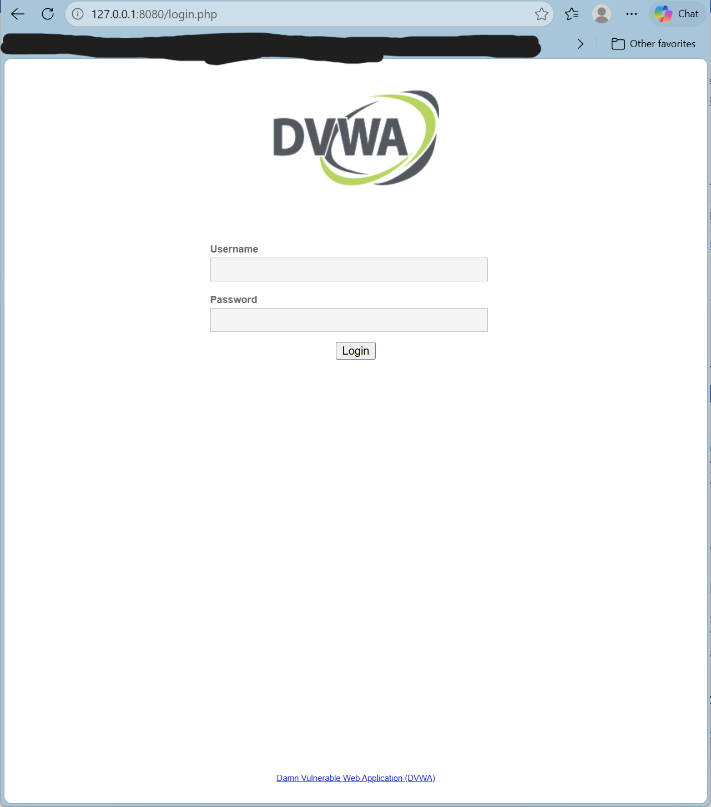

--------------------------------------------------------------------------------------------------------------------------------------------------------------------------------------------


### 6. Database Setup & Login
- Navigated to `Setup / Reset DB` page
- Verified Setup Check: MySQL installed, PHP modules installed, Apache running
- Clicked **Create / Reset Database**
- Logged in: `admin` / `password`
- Accessed full DVWA dashboard with vulnerability modules: SQL Injection, XSS, Brute Force, CSRF, Command Injection, File Upload, etc.

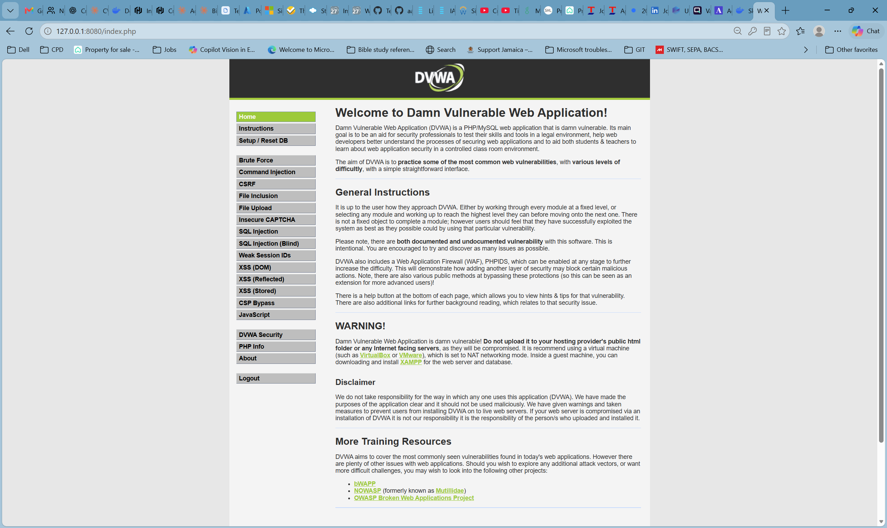

--------------------------------------------------------------------------------------------------------------------------------------------------------------------------------------------


### 7. Stop the Container
```bash
docker stop gallant_pare
```
Gracefully shut down the running container. Docker Desktop confirmed **No containers are running**.

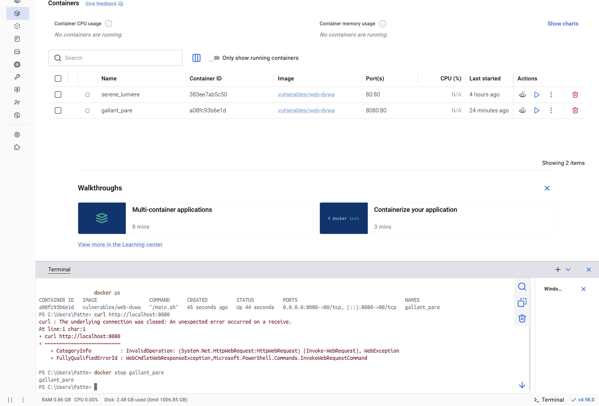

--------------------------------------------------------------------------------------------------------------------------------------------------------------------------------------------


### 8. Remove the Container
```bash
docker rm gallant_pare
```
Deleted the container instance entirely. Only the original `serene_lumiere` (also stopped) remains in history.

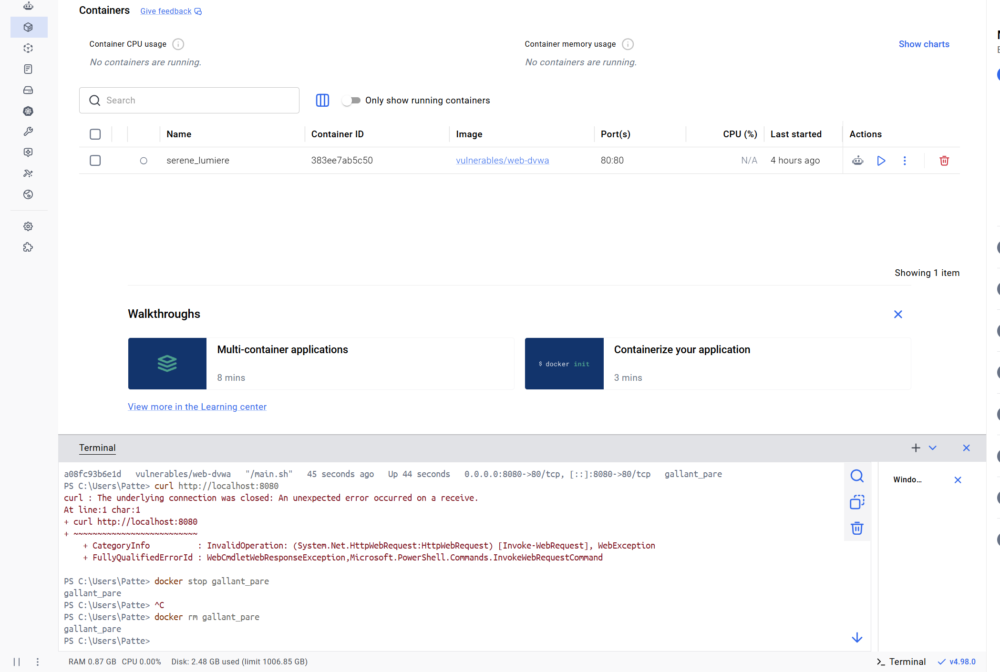

--------------------------------------------------------------------------------------------------------------------------------------------------------------------------------------------


### 9. Verify Image Persists
```bash
docker images
```
Output confirmed `vulnerables/web-dvwa:latest` (935MB) still exists locally, demonstrating the key concept that **containers are temporary; images are persistent**. A new container can be spun up instantly from the same image at any time.

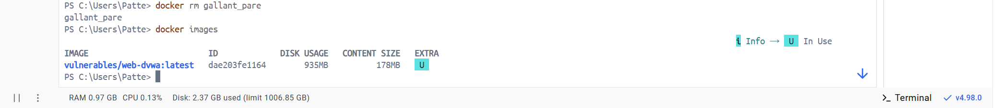

--------------------------------------------------------------------------------------------------------------------------------------------------------------------------------------------


## Key Concepts Demonstrated

|        Concept        |               Applied                     |
|-----------------------|-------------------------------------------|
| Container lifecycle   |    Pull → Run → Stop → Remove             |
| Port mapping          | `-p 8080:80` host-to-container mapping    |
| Loopback networking   | `127.0.0.1` vs `localhost` behaviour      |
| Container vs image    | Image persists after container removal    |
| Log inspection        | `docker logs` to verify internal services |
| Containerised web app | DVWA running isolated from host system    |

--------------------------------------------------------------------------------------------------------------------------------------------------------------------------------------------


## Security Relevance
DVWA is used by security teams and SOC analysts to:
- Practise identifying and exploiting common OWASP Top 10 vulnerabilities (SQL injection, XSS, CSRF)
- Test WAF (Web Application Firewall) rules in a safe environment
- Train developers on secure coding practices

Running it in Docker ensures complete isolation from the host - the vulnerable application cannot affect the underlying system.

--------------------------------------------------------------------------------------------------------------------------------------------------------------------------------------------

## 10. Web Vulnerability Testing & Detection (OWASP Top 10)

With DVWA running and security set to **Low**, I tested two of the most common web
vulnerabilities, then confirmed the fix and found the attack in the server logs.

> All testing was done against my own isolated container on `127.0.0.1`. DVWA is
> built for this purpose; these techniques must never be used on systems you do
> not own.

| Attack | What I entered | What happened | Secure fix (at "Impossible") | OWASP Top 10 |
|---|---|---|---|---|
| SQL Injection | `1' OR '1'='1` in the User ID box | Returned **all** users instead of one - the input changed the database query | Prepared statements (input treated as data, not code) | A03: Injection |
| Reflected XSS | `<script>alert('XSS')</script>` in the name box | Pop-up fired - the page ran my input as code, for this request only | Output encoding (`htmlspecialchars`) | A03: Injection |
| Stored XSS | Same script saved in the guestbook | Pop-up fires on **every** page load, for every visitor - the script is stored in the database | Output encoding on display | A03: Injection |

### SQL Injection
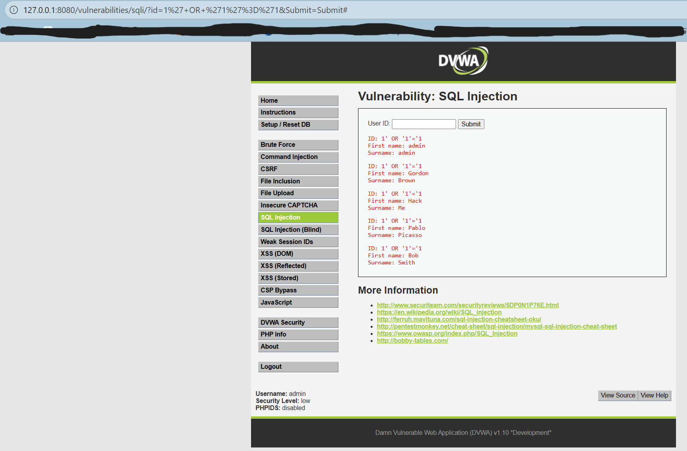

### Reflected XSS
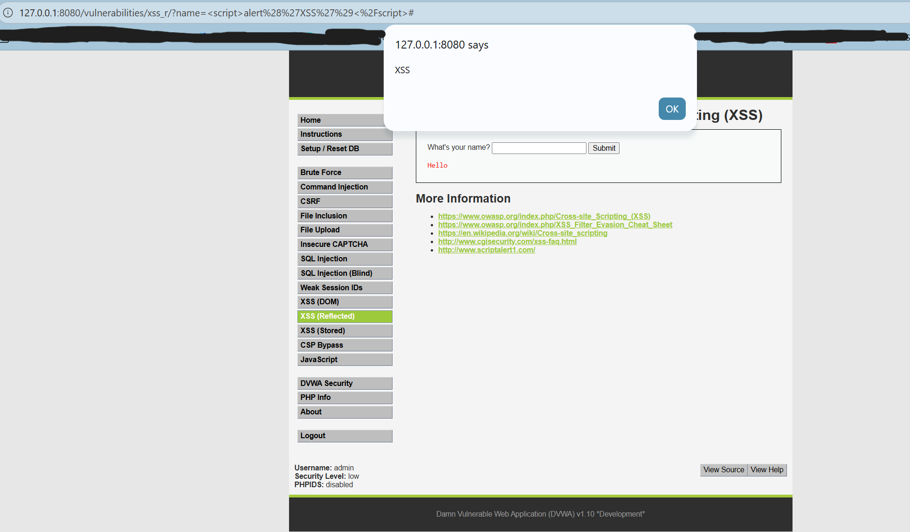

### Stored XSS
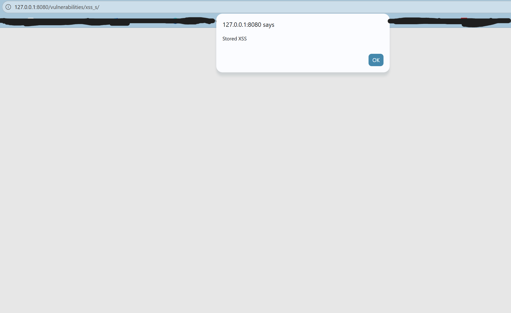

### Detecting the attack in the logs (the SOC view)
After attacking, I inspected the container's access log - the same place a SOC
analyst would look:

```bash
docker ps                               # find the container name
docker logs festive_lehmann --tail 30   # read the web access log
```

The injection attempts appear as URL-encoded payloads in the log:
- **SQL injection:** `/vulnerabilities/sqli/?id=1%27+OR+%271%27%3D%271` - `%27` is an
  encoded apostrophe (`'`)
- **Reflected XSS:** `/vulnerabilities/xss_r/?name=%3Cscript%3E` - `%3Cscript%3E` is
  an encoded `<script>` tag

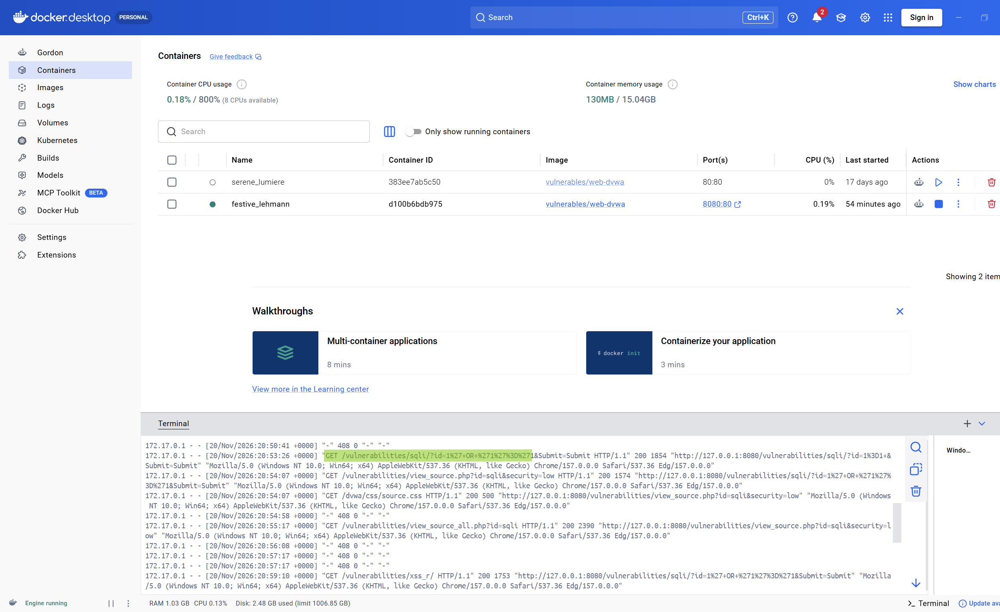

> **Note:** the **stored XSS** does not appear in the URL, because it was sent as a
> form submission (POST), not a GET request. A SOC analyst would need request-body
> logging or a WAF to catch it — a useful reminder that URL monitoring alone is not
> enough.

**Why this matters:** `%27` and `%3Cscript%3E` are exactly the patterns a SIEM rule
or Web Application Firewall (WAF) is written to flag. This lab shows both sides -
how the attack is sent, and how it is detected in the logs.


--------------------------------------------------------------------------------------------------------------------------------------------------------------------------------------------


## Repository
Part of my cybersecurity home lab portfolio: [github.com/aap-soc](https://github.com/aap-soc)
